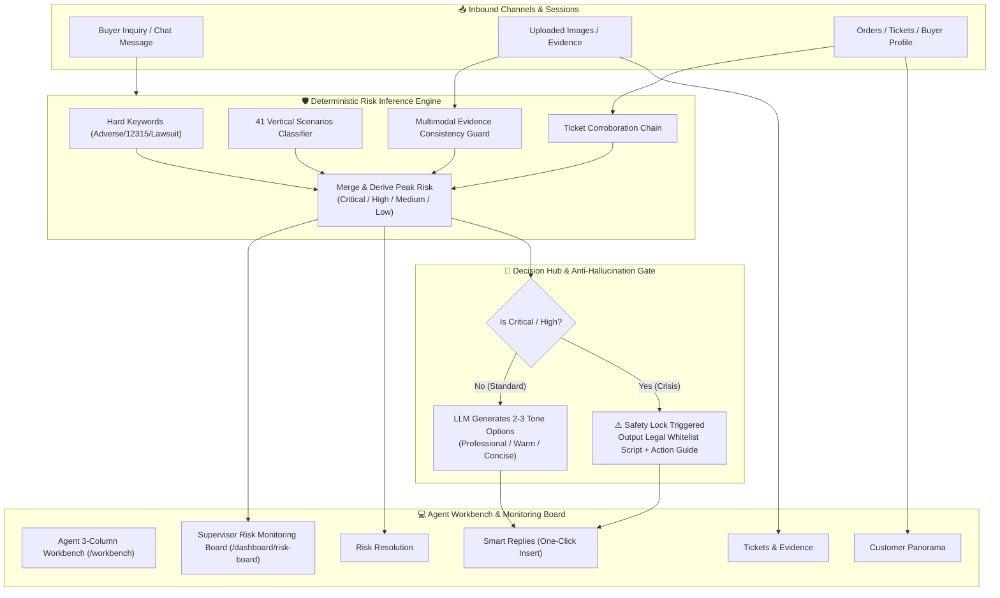

# Data-Empathetic Customer Support Agent

English | [简体中文](README_ZH.md)

> ⚖️ **Derivative Work & License Notice**  
> This project is a derivative work based on the open-source customer service system [agent-desk](https://github.com/mlogclub/agent-desk) (Apache-2.0 License). All original licenses and copyright notices are preserved.  
> This repository focuses on **e-commerce agent decision-support co-pilot, deterministic risk inference engines, and hallucination-free compliance guards**.

---

## 💡 Philosophy & Positioning

> **"Not a cold robot replacement, but a high-confidence decision co-pilot and compliance gatekeeper for e-commerce support agents."**

During promotional seasons and high-dispute scenarios, frontline support agents handle dozens of concurrent sessions. Fully automated LLM bots often hallucinate unwarranted promises or misunderstand complex complaints, whereas manual operations suffer from slow response times and audit oversights.

**Data-Empathetic Customer Support Agent** delivers:
1. **Deterministic Risk Inferences**: Risk classification is never left to LLM guesswork. Using deterministic hard keywords + 41 domain scenario classifiers + ticket and multimodal evidence chains, it achieves 100% auditable 5-level risk derivation (Critical / High / Medium / Low / None).
2. **Human-in-the-Loop Tone Suggestions**: Generates 2–3 tone candidates (Professional, Warm, Concise) with confidence scores and rationale. For critical redlines (severe adverse reactions, counterfeit claims), **free generation is automatically fused**, switching to legal-vetted compliance whitelist templates.
3. **Cross-System Customer Insights**: Instantly synthesizes order details, 5 categories of historical tickets, buyer value profiles, and multimodal evidence consistency (e.g. detecting mismatch between reported damage and uploaded swatches).

---

## 🏛️ System Architecture



---

## 🌟 Key Features

- 🛡️ **Deterministic 5-Level Risk Derivation**:
  - **Safety**: Adverse reactions, skin damage, hospital visits (Direct Critical lock).
  - **Compliance**: Counterfeit allegations, consumer bureau complaints, legal threats.
  - **Timeliness**: Logistics stagnation, delayed refunds, overdue commitments.
  - **Public Opinion**: Social media smear threats, negative review extortion.
  - **Experience**: Missing gifts, damaged parcels, wrong items delivered.
- 💬 **3-Tone Adaptive Suggestions & One-Click Insert**:
  - LLM outputs candidates in Professional, Warm, and Concise tones. Frontline agents can review and insert directly with a single click.
- 🔒 **Legal Compliance Whitelist Failsafe**:
  - Blocks hallucinations on crisis tickets. Restricts outputs to legally validated calming templates and escalates to specialists.
- 📦 **ERP-Free Customer 360 Panorama**:
  - Real-time order items, amounts, order statuses, batch numbers, and historical spend.
- 🚨 **Supervisor Risk Board & Batch Outbreak Alerts**:
  - Aggregated view of crisis sessions with batch clustering (e.g., product batch #00 allergic reaction spikes).

---

## 🚀 Quick Start in 3 Commands

Pre-configured with automatic SQLite migrations and 138 de-identified realistic benchmark sessions. Run locally with zero external DB setup.

### 1. Start the Backend
```bash
# In agent-desk root directory
cd agent-desk

# Copy configuration
cp config/config.example.yaml config/config.yaml

# Start Go server (automatically runs migrations and seeds 138 demo sessions)
go run ./cmd/server
```
*Backend runs on `http://127.0.0.1:8083`.*

> 💡 **Manual Seed**: Run `go run ./cmd/seed -reset` anytime to reset and re-seed initial benchmark data.

### 2. Start the Frontend
```bash
cd web
pnpm install
pnpm dev
```
*Frontend runs on `http://localhost:3000`.*

### 3. Access the Application
- **Agent Workbench**: [http://localhost:3000/workbench](http://localhost:3000/workbench) (Experience 4-drawer co-pilot and one-click insertion)
- **Supervisor Risk Board**: [http://localhost:3000/dashboard/risk-board](http://localhost:3000/dashboard/risk-board) (Global risk overview and escalation)

---

## 📊 Benchmark & Evaluation

- **Intent & Scenario Recognition**: Evaluated on 138 de-identified customer service test cases covering 10 major and 41 minor categories. Achieves **93.13% accuracy** (Macro-F1: 0.937).
- **Rule Engine Latency**: Pure in-memory Go rule engine with single-session evaluation latency `< 1ms`.

---

## 📖 Documentation Index

Full architecture specifications and design records are maintained under [`docs/`](docs/):

- [Product Requirements Document (PRD)](docs/prd.md)
- [System Architecture Overview](docs/architecture.md)
- [Qianniu Plugin & Data Flow Guide](docs/qianniu_plugin_and_dataflow.md)
- [Open Source Selection & Modifications](docs/open_source_selection.md)
- [Operations & Runbook](docs/runbook.md)
- [Changelog & Incident Reviews](docs/CHANGELOG.md)

---

## 🎯 Known Limitations & Roadmap

We prioritize engineering honesty over polished illusions:

1. **E-Commerce Plugin Gateways & Offline Demo Pipeline**:
   - *Current*: Due to enterprise qualification requirements on Taobao Open Platform / Jushita, the system currently operates as a standalone web workspace emulating the right-panel plugin format using 138 embedded de-identified test cases. In the offline ETL pipeline (`pipeline.py`), the top 2 test cases are tagged with `demo_pinned` for predictable interactive presentations.
   - *Roadmap*: Provide standard Chrome extension / Jushita gateway adapters for plug-and-play production deployment.
2. **Vertical Rule Classifier Generalization**:
   - *Current*: 41-scenario classification relies on beauty domain-specific lexical rules. Highly accurate for cosmetics, but requires lexicon updates for other sectors.
   - *Roadmap*: Incorporate lightweight embedding retrieval and fine-tuned classifiers as hybrid layers.
3. **Automated Business Actions (Procedures)**:
   - *Current*: Focuses on decision co-piloting and script suggestions without direct ERP write-backs (e.g. automated refunds).
   - *Roadmap*: Integrate Tool Calling / MCP (Model Context Protocol) for verified automated actions like order freezing.
4. **Data Flywheel & Online Evaluation**:
   - *Current*: Lacks automated live feedback loops for agent acceptance rates.
   - *Roadmap*: Implement telemetry logging on suggestion adoption/edits and continuous regression pipelines.
5. **Completed Engineering Hardening**:
   - ✅ **Reply Cache Memory Leak Fix**: Replaced unbounded map with 30-min TTL & LRU-bounded cache.
   - ✅ **Transactional Event Persistence**: Wrapped delete + batch create in `sqls.DB().Transaction` to prevent concurrency losses.
   - ✅ **GORM Schema Drift Fix**: Added missing product, status, and batch columns to SQLite tables.
   - ✅ **Embedded Zero-Config Seed**: Packaged benchmark data into Go binary with automatic seed on startup.

---

## 📄 License

This project is licensed under the [Apache-2.0 License](LICENSE).
