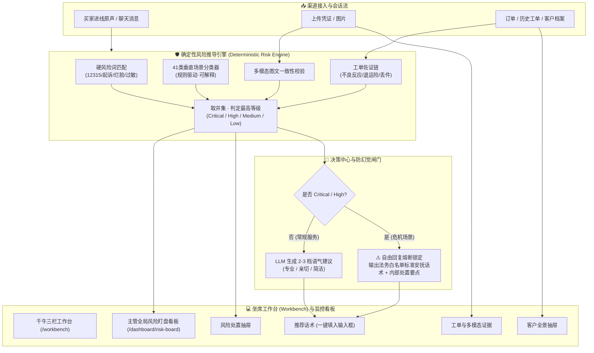

# 数据共情者 · 电商智能客服决策辅佐与风控系统

[English](README.md) | 简体中文

> ⚖️ **开源衍生与合规声明 (Derivative Work Notice)**  
> 本项目基于开源客服系统 [agent-desk](https://github.com/mlogclub/agent-desk) (Apache-2.0 License) 二次开发。保留上游完整许可证与版权声明。  
> 本系统针对电商客服场景（美妆/大促/高客诉），专注于构建**一线坐席决策外挂、确定性风险推导引擎与合规防幻觉机制**。

---

## 💡 产品定位与设计理念

> **“不做冰冷的替代型机器人，做坐席右侧递小纸条的决策外挂与合规风控闸门。”**

在大促或高客诉场景下，一线客服通常同时挂着数十个会话窗口，不仅要核验订单、辨别过敏等高危风险，还要承受极短的响应时效要求。传统的对话机器人往往容易产生“幻觉乱承诺”，或者答非所问；而完全靠人工不仅容易疏漏，也易触发监管舆情。

**数据共情者**的核心定位是：
1. **风险定级绝不由大模型决定**：采用确定性硬词典 + 垂直场景规则 + 工单与多模态证据链，实现 100% 可审计、可解释的确定性定级（Critical / High / Medium / Low / None）。
2. **话术建议把控在人手中**：大模型自由生成 2~3 档候选语气（专业、亲切、简洁），附带置信度与推荐依据；针对烂脸、过敏、假货等高危红线，**自动阻断自由生成**，切换为法务白名单合规话术。
3. **多维证据链全景透视**：秒级穿透订单、5类历史工单、买家价值画像及图文证据一致性（识别买家“口述破损却发色卡”等异常）。

---

## 🏛️ 系统架构



---

## 🌟 核心特性

- 🛡️ **确定性五级风险引擎**：
  - **人身安全 (Safety)**：过敏、就医、烂脸，直接锁定 Critical 等级。
  - **合规侵权 (Compliance)**：打假、315 投诉、假一赔十、法务诉讼。
  - **时效焦虑 (Timeliness)**：发货停滞、退款不到账、超时承诺。
  - **舆情危机 (Opinion)**：小红书/微博曝光威胁、差评威胁。
  - **体验受损 (Experience)**：漏发、错发、包装破损。
- 💬 **3 档语气建议与一键填入**：
  - 后端大模型根据会话生成【专业】、【亲切】、【简洁】3 档候选，前端支持一键填入输入框，兼顾效率与客服把关。
- 🔒 **合规白名单安抚熔断**：
  - 高危会话严禁 LLM 随意承诺赔付，自动切换为法务审定的白名单标准话术与专员接管指引。
- 📦 **免查 ERP 的客户全景**：
  - 关联订单金额、商品名称、物流状态、历史到访频次、实付总额一屏尽览。
- 🚨 **客服主管风险盯盘看板**：
  - 实时按严重等级筛选危机，支持批次号聚集预警（如某批次不良反应集中爆发）。

---

## 🚀 3 步极速启动

系统内置自动迁移与 138 条真实业务脱敏评测样本，**无需预先配置数据库即可单机体验**。

### 1. 启动后端服务
```bash
# 进入工程根目录
cd agent-desk

# 准备配置文件（默认使用内置 SQLite 与内存模式）
cp config/config.example.yaml config/config.yaml

# 启动 Go 服务（会自动完成 DB 初始化与 138 条脱敏数据注入）
go run ./cmd/server
```
*后端服务将运行在 `http://127.0.0.1:8083`。*

> 💡 **重新灌入演示数据**：任何时候均可运行 `go run ./cmd/seed -reset` 重新注入初始评测数据。

### 2. 启动前端工作台
```bash
cd web
pnpm install
pnpm dev
```
*前端默认监听 `http://localhost:3000`。*

### 3. 访问系统
- **千牛三栏坐席工作台**：[http://localhost:3000/workbench](http://localhost:3000/workbench) （体验一线客服四抽屉协同与一键填入）
- **主管风险看板**：[http://localhost:3000/dashboard/risk-board](http://localhost:3000/dashboard/risk-board) （全局风险态势与处置闭环）

---

## 📊 评测基准与业务指标

- **意图与场景识别**：基于 138 条真实客诉脱敏评测集，覆盖 10 大类、41 子类，意图识别准确率达 **93.13%** (Macro-F1: 0.937)。
- **规则执行性能**：Go 纯内存状态机推导，单会话推导延迟 `< 1ms`，零网络开销与零并发瓶颈。

---

## 📖 详细设计与文档导航

完整项目工程规范与演进记录已归档至 [`docs/`](docs/)：

- [产品需求文档 (PRD)](docs/prd.md) —— 业务场景与千牛插件交互规范
- [项目架构总览](docs/architecture.md) —— 分层架构、数据流与防幻觉设计
- [千牛插件形态与数据通路说明](docs/qianniu_plugin_and_dataflow.md) —— 为什么做右侧外挂、离线评测与准入边界
- [开源选型与改造清单](docs/open_source_selection.md) —— 技术选型依据与 License 红线规范
- [运行手册](docs/runbook.md) —— 本地与 Docker 环境完整部署指南
- [变更历史 (CHANGELOG)](docs/CHANGELOG.md) —— 迭代轨迹与工程问题复盘

---

## 🎯 诚实局限性与演进计划 (Roadmap)

我们坚持工程诚实，不将演示环境粉饰为万能生产系统。目前已知的架构局限与演进计划如下：

1. **真实电商插件准入门槛与离线演示机制**：
   - *现状*：受限于淘宝开放平台/聚石塔的企业实名与商家付费资质门槛，当前以独立 Web 坐席工作台模拟千牛右侧栏插件形态，采用内置 138 条脱敏真实数据与工作流驱动。离线数据管道脚本（`pipeline.py`）对前 2 条评测会话标记了 `demo_pinned` 置顶以便交互演示。
   - *演进*：提供标准 Chrome Extension / 聚石塔网关适配器，支持在真实千牛开放接口就绪后即插即用。
2. **垂直规则分类器的泛化边界**：
   - *现状*：当前 41 类分类器主要基于美妆垂类词法模式与状态机规则构建。针对美妆场景具有极高执行确定性，但跨行业（如数码、服装）需重新适配词库。
   - *演进*：引入 Small Embedding 语义检索与微调分类头作为规则引擎的平滑补充。
3. **业务操作闭环 (Actions & Procedures)**：
   - *现状*：当前系统核心定位是“坐席辅佐外挂”，提供风险揭示与话术建议，尚不能直连 ERP 自动化执行扣款或退款动作。
   - *演进*：接入 Tool Calling / MCP (Model Context Protocol) 协议，扩展订单锁定与工单创建等可控业务动作。
4. **数据飞轮与评测闭环**：
   - *现状*：目前缺乏线上坐席对话数据实时回流及采纳率自动化 A/B 测试。
   - *演进*：构建客服话术采纳/修改记录的回流日志，建立回归评估管线反哺模型策略。
5. **已完成的工程治理 (Production Readiness)**：
   - ✅ **修复回复缓存内存泄漏**：实现基于 30 分钟 TTL 与 LRU 容量上限的线程安全缓存，防止长期运行内存膨胀。
   - ✅ **事务保障事件落库**：重构 `PersistEvents`，在单事务中完成幂等删除与批量创建，杜绝并发竞争丢事件。
   - ✅ **对齐 GORM 模型与数据库 Schema**：补齐 `cs_session_context` 的订单商品、状态与批次号字段，根除 Schema 漂移。
   - ✅ **自动化内置 Seed 支持**：集成嵌入式脱敏数据与 `cmd/seed` CLI，新克隆仓库一键即可无缝启动。

---

## 📄 开源许可证

本项目遵循 [Apache-2.0 License](LICENSE)。
